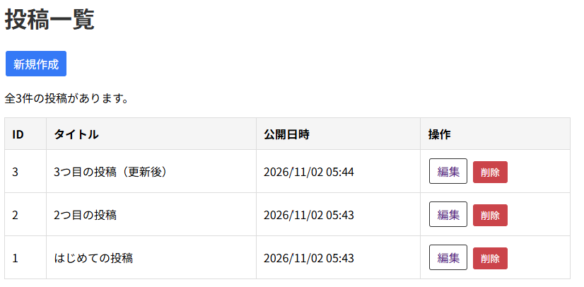
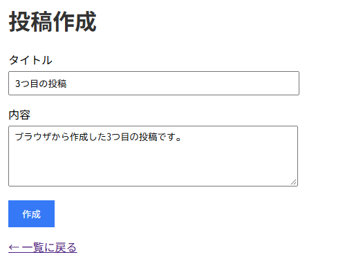
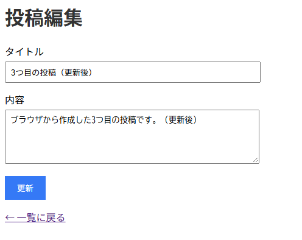

# eloquent-app-practice

## 概要
COACHTECH 教材 Tutorial 9-4「Eloquent ORM ハンズオン演習」で作成した成果物です。
Eloquent ORMを活用し、投稿を作成・表示・編集・削除できる機能を実装しました。投稿を管理するテーブルを作成し、ブラウザでの入力情報をデータベースへ反映させる仕組みを作成しました。

## 使用技術
- PHP 8.5.12
- Laravel 10.50.4
- Eloquent ORM
- MySQL

## 学んだこと
- Eloquentモデルを活用し、データベースに対してCRUD操作を行う方法
- マスアサインメントを活用する際に$fillableを定義して、セキュリティを向上させる方法
- ブラウザで入力された値に対して、validateメソッドによって入力内容が有効であるかの確認をする方法

## 動作確認
1. eloquent-app-practiceディレクトリ上でsail up -dコマンドによりyamlファイルに記述した構成通りのコンテナを起動させてネットワークで連携
2. sail artisan migrateコマンドによりテーブルを作成
3. sail artisan db:seed --class=PostSeederコマンドによりテーブルに初期値を設定する
4. ブラウザで「`http://localhost/posts`」のURLにアクセスして投稿一覧ページが表示されることを確認
5. 「新規作成」押下で投稿作成画面に遷移して投稿を作成
6. 「編集」押下で変種画面に遷移し、変種した内容が反映されているか確認
7. 「削除」押下で該当する投稿が削除されることを確認

## 詰まったポイントと解決方法
- マイグレーションでdatetime型として定義したpublished_atが文字列として扱われていたため、Blade内のformat()メソッドを使った日時の表示ができず、エラーが発生した  
  ┗Postモデルの$castsに「'published_at' => 'datetime'」を追加し、日時オブジェクトへの型変換を行うことで解決した

## 開発の工夫
- Artisan Tinkerを活用してテーブルの作成や初期データの挿入が正常に行われているかを確認しながら進めた
- リソースコントローラーを活用し、必要なメソッドが事前に準備された状態でコントローラーの実装を進めた
- モデル内で$fillableによってマスアサインメントで代入を許可するカラムを設定することで、セキュリティ面を考慮した設計にした
- 投稿作成や編集の際に、ブラウザで入力された値に対してvalidateメソッドにより事前に検証したうえでデータベースに反映させるようにした

## 動作確認のスクリーンショット
1. 「`http://localhost/posts`」にアクセスした時の投稿一覧画面

2. 投稿を新規作成する時の画面

3. 投稿を編集する時の画面
